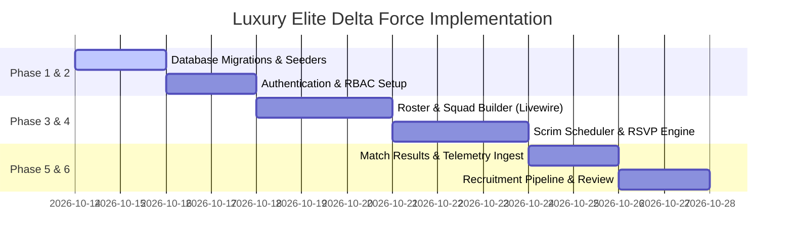

# MANAGEMENT_SPEC.md: Luxury Elite Esports Platform (Delta Force Edition)

> **Document Status:** Active Specification  
> **Target Framework:** Laravel 11.x, PHP 8.3+, Tailwind CSS v3.4+, Alpine.js / Livewire 3.x, MySQL 8.0+ / SQLite 3  
> **Version:** 1.0.0 (Production Blueprint)  
> **Target Game:** Delta Force (Team Jade / TiMi Studio Group)

---

## Table of Contents
1. [System Vision & Domain Architecture](#1-system-vision--domain-architecture)
   - 1.1 Brand Identity & Design System (Luxury Dark-Gold & Tactical Carbon)
   - 1.2 Architectural Boundaries (Public Portal vs. Tactical Command Ops)
2. [Delta Force Game Mode Specifications & Scoring Models](#2-delta-force-game-mode-specifications--scoring-models)
   - 2.1 Detonation Engine (5v5 Search & Destroy)
   - 2.2 Hazard Operations Engine (3v3 Tactical Extraction)
   - 2.3 Havoc Warfare Engine (32v32 Combined Arms Conquest)
3. [Role-Based Access Control (RBAC) Matrix](#3-role-based-access-control-rbac-matrix)
4. [Relational Database Schema & Eloquent Blueprints](#4-relational-database-schema--eloquent-blueprints)
   - 4.1 Migration Specs & Table Blueprints
   - 4.2 Eloquent Models, Casts & Relationships
5. [API Contracts, Routing & Controller Action Matrix](#5-api-contracts-routing--controller-action-matrix)
   - 5.1 Route Inventory (`routes/web.php` & `routes/api.php`)
   - 5.2 Controller & Livewire Component Specifications
6. [Phased Implementation Roadmap](#6-phased-implementation-roadmap)

---

## 1. System Vision & Domain Architecture

### 1.1 Brand Identity & Design System (Luxury Dark-Gold & Tactical Carbon)
Luxury Elite represents elite tactical supremacy and prestigious clan culture. The UI/UX theme pairs military telemetry ergonomics with sleek, high-end luxury styling:
- **Palette Tokens:**
  - Base Background: `obsidian-950` (`#0B0D11`)
  - Elevated Cards / Surfaces: `carbon-900` (`#14171F`), `carbon-800` (`#1D222E`)
  - Accent / Primary Gold: `gold-500` (`#D4AF37`), `gold-400` (`#E5C158`), `gold-600` (`#AA8423`)
  - Border Accents: `gold-500/20` & `carbon-700/50`
  - Functional Alerts: Emerald `#10B981` (Extraction/Win), Crimson `#EF4444` (KIA/Defeat), Amber `#F59E0B` (Tentative/Under Review)
- **Typography:** Display: `Outfit` / `Syne`; UI & Monospace Telemetry: `JetBrains Mono` / `Inter`.
- **Aesthetic Elements:** Subtle grid underlays, HUD angular borders, gold glow highlights (`box-shadow: 0 0 20px rgba(212, 175, 55, 0.15)`), and glassmorphism backdrops (`backdrop-blur-md bg-carbon-900/80`).

### 1.2 Architectural Boundaries
```
+-----------------------------------------------------------------------------------+
|                           LUXURY ELITE PLATFORM DOMAIN                            |
+---------------------------------------------------+-------------------------------+
|               PUBLIC TACTICAL PORTAL              |      MANAGEMENT OPS PORTAL    |
|               (Guest / Fan Viewers)               |   (Staff, Captains & Roster)  |
+---------------------------------------------------+-------------------------------+
| - Homepage Showcase & Clan Reel                   | - Dynamic Scrim Scheduler     |
| - Delta Force Division Rosters                    | - Live RSVP Telemetry Engine  |
| - Match Center (Recent Results, VODs, Brackets)   | - Roster & Squad Builder      |
| - "Join Squad" Recruitment Application Pipeline   | - Match Result & Proof Ingest |
| - Clan Leaderboard & Hall of Fame                 | - Recruitment Triage Kanban   |
+---------------------------------------------------+-------------------------------+
```

---

## 2. Delta Force Game Mode Specifications & Scoring Models

### 2.1 Detonation Engine (5v5 Search & Destroy)
- **Format:** Competitive bomb plant/defuse. 5 Attackers vs 5 Defenders per round.
- **Match Sets:** Best of 1 (BO1), Best of 3 (BO3), or Best of 5 (BO5).
- **Round Logic:** First to 11 rounds or overtime tie-breaker at 10-10. Half-time side switch at round 10.
- **Round Metric Capture:**
  - `site_planted`: `A`, `B`, or `none`
  - `win_condition`: `elimination`, `detonation`, `defusal`, `time_expired`
  - Attack/Defense split records (`atk_rounds_won`, `def_rounds_won`).

### 2.2 Hazard Operations Engine (3v3 Tactical Extraction)
- **Format:** High-stakes extraction shooter in 3-man squads (Trios).
- **Raid Outcome Status:**
  - `EXTRACTED` (Player successfully extracted to safe zone with equipment & loot).
  - `KIA` (Killed in Action - loot dropped).
  - `MIA` (Missing in Action - timer expired without extraction).
- **Telemetry & Economy Tracking:**
  - `loot_value`: Total monetary value extracted (Delta Force Tekniq / Cash value in Millions).
  - `mandelbrick_secured`: Boolean flag indicating if high-value classified MandelBrick was successfully extracted.
  - Squad survival rating: `3/3 Safe`, `2/3 Partial`, `1/3 Lone Wolf`, `0/3 Squad Wipe`.

### 2.3 Havoc Warfare Engine (32v32 Combined Arms Conquest)
- **Format:** Large-scale 32v32 combined arms combat across mega-maps.
- **Platoon Subdivision (4 Squads of 8 per team):**
  - Squad Alpha: *Frontline Infantry / Assault Division*
  - Squad Bravo: *Armor & Heavy Mechanized Division (Tanks/LAVs)*
  - Squad Charlie: *Air Defense & Aviation Division (Helicopters)*
  - Squad Delta: *Recon & Tactical Combat Support (Mortars/Drones)*
- **Ticket Scoring Model:**
  - Starts at 1000 tickets per faction.
  - Depletion rate based on sector control (A1, A2, B1, B2, C1, C2) and casualty respawns.

---

## 3. Role-Based Access Control (RBAC) Matrix

| Permission Key | Superadmin (Owner) | Manager | Head Coach | Competitive Player | Casual Member | Public Guest |
| :--- | :---: | :---: | :---: | :---: | :---: | :---: |
| `view-public-roster-and-matches` | Yes | Yes | Yes | Yes | Yes | Yes |
| `apply-recruitment` | No | No | No | No | No | Yes |
| `rsvp-scrim` (Self RSVP) | Yes | Yes | Yes | Yes | Yes | No |
| `view-tactical-dashboard` | Yes | Yes | Yes | Yes | Yes | No |
| `manage-squad-lineups` | Yes | Yes | Yes | Captain Only | No | No |
| `schedule-scrims` | Yes | Yes | Yes | No | No | No |
| `input-match-results-and-vod` | Yes | Yes | Yes | Captain Only | No | No |
| `submit-coach-evaluations` | Yes | Yes | Yes | No | No | No |
| `review-recruitment-applications` | Yes | Yes | No | No | No | No |
| `manage-users-and-roles` | Yes | No | No | No | No | No |

---

## 4. Relational Database Schema & Eloquent Blueprints

### 4.1 Migration Specs & Table Blueprints

#### 1. `users` Table
```php
Schema::create('users', function (Blueprint $table) {
    $table->id();
    $table->string('name');
    $table->string('email')->unique();
    $table->timestamp('email_verified_at')->nullable();
    $table->string('password');
    $table->enum('role', [
        'superadmin',
        'manager',
        'coach',
        'competitive_player',
        'casual_member'
    ])->default('casual_member')->index();
    $table->string('avatar_path')->nullable();
    $table->string('discord_username')->nullable();
    $table->string('phone_number')->nullable();
    $table->boolean('is_active')->default(true);
    $table->rememberToken();
    $table->timestamps();
});
```

#### 2. `game_modes` Table
```php
Schema::create('game_modes', function (Blueprint $table) {
    $table->id();
    $table->string('name'); // Detonation, Hazard Operations, Havoc Warfare
    $table->string('slug')->unique(); // detonation, hazard-operations, havoc-warfare
    $table->string('code', 10)->unique(); // DET, HAZ, HVC
    $table->unsignedTinyInteger('team_size'); // 5, 3, 32
    $table->text('description')->nullable();
    $table->string('icon_url')->nullable();
    $table->boolean('is_competitive')->default(true);
    $table->timestamps();
});
```

#### 3. `player_profiles` Table
```php
Schema::create('player_profiles', function (Blueprint $table) {
    $table->id();
    $table->foreignId('user_id')->constrained('users')->cascadeOnDelete();
    $table->string('in_game_name')->index(); // Delta Force IGN
    $table->string('delta_force_uid', 32)->unique(); // Official UID in game
    $table->enum('player_type', ['competitive', 'casual', 'trial', 'inactive'])->default('trial')->index();
    $table->enum('preferred_class', ['assault', 'engineer', 'support', 'recon'])->default('assault');
    $table->string('signature_operator')->nullable(); // D-Wolf, Stinger, Luna, Shepherd, etc.
    $table->string('rank_tier')->default('Pinnacle'); // Bronze, Silver, Gold, Platinum, Diamond, Master, Pinnacle
    $table->unsignedInteger('rank_score')->default(0);
    $table->decimal('kd_ratio', 4, 2)->default(0.00);
    $table->decimal('win_rate', 5, 2)->default(0.00); // Percentage 0 - 100.00%
    $table->unsignedBigInteger('total_extraction_value')->default(0); // For Hazard Ops in Tekniq
    $table->json('social_links')->nullable(); // Twitch, YouTube, TikTok, X
    $table->timestamps();
});
```

#### 4. `squads` Table
```php
Schema::create('squads', function (Blueprint $table) {
    $table->id();
    $table->foreignId('game_mode_id')->constrained('game_modes')->cascadeOnDelete();
    $table->foreignId('captain_id')->nullable()->constrained('users')->nullOnDelete();
    $table->string('name'); // e.g., "Luxury Elite Alpha", "Luxury Elite Hazard Trio 1"
    $table->string('slug')->unique();
    $table->enum('division_tier', ['tier_1_pro', 'tier_2_academy', 'community'])->default('tier_1_pro');
    $table->string('motto')->nullable();
    $table->string('logo_path')->nullable();
    $table->boolean('is_active')->default(true);
    $table->timestamps();
});
```

#### 5. `squad_members` Table
```php
Schema::create('squad_members', function (Blueprint $table) {
    $table->id();
    $table->foreignId('squad_id')->constrained('squads')->cascadeOnDelete();
    $table->foreignId('player_profile_id')->constrained('player_profiles')->cascadeOnDelete();
    $table->enum('lineup_role', ['starter', 'substitute', 'analyst', 'standin'])->default('starter');
    $table->string('tactical_position')->nullable(); // IGL, Entry Fragger, Anchor, Sniper, Driver, Pilot
    $table->date('joined_date')->useCurrent();
    $table->timestamps();

    $table->unique(['squad_id', 'player_profile_id']);
});
```

#### 6. `scrim_matches` Table
```php
Schema::create('scrim_matches', function (Blueprint $table) {
    $table->id();
    $table->foreignId('squad_id')->constrained('squads')->cascadeOnDelete();
    $table->foreignId('game_mode_id')->constrained('game_modes')->cascadeOnDelete();
    $table->string('opponent_name');
    $table->string('opponent_logo')->nullable();
    $table->enum('match_format', ['BO1', 'BO2', 'BO3', 'BO5', 'CUSTOM'])->default('BO3');
    $table->date('match_date')->index();
    $table->time('time_wib')->index(); // Matches held in Western Indonesian Time (WIB)
    $table->string('custom_room_id')->nullable();
    $table->string('custom_room_password')->nullable();
    $table->string('server_region')->default('Asia / Southeast Asia');
    $table->enum('status', ['scheduled', 'ongoing', 'completed', 'cancelled', 'forfeit'])->default('scheduled')->index();
    $table->text('briefing_notes')->nullable();
    $table->timestamps();
});
```

#### 7. `scrim_attendances` Table
```php
Schema::create('scrim_attendances', function (Blueprint $table) {
    $table->id();
    $table->foreignId('scrim_match_id')->constrained('scrim_matches')->cascadeOnDelete();
    $table->foreignId('user_id')->constrained('users')->cascadeOnDelete();
    $table->enum('rsvp_status', ['attending', 'tentative', 'absent'])->default('tentative')->index();
    $table->string('reason')->nullable(); // Obligatory if absent/tentative
    $table->timestamp('responded_at')->nullable();
    $table->timestamps();

    $table->unique(['scrim_match_id', 'user_id']);
});
```

#### 8. `match_results` Table
```php
Schema::create('match_results', function (Blueprint $table) {
    $table->id();
    $table->foreignId('scrim_match_id')->unique()->constrained('scrim_matches')->cascadeOnDelete();
    $table->unsignedSmallInteger('luxury_score')->default(0);
    $table->unsignedSmallInteger('opponent_score')->default(0);
    $table->enum('outcome', ['victory', 'defeat', 'draw'])->index();
    $table->json('maps_played')->nullable(); // e.g. [{"map": "Zero Dam", "score_us": 11, "score_them": 7}]
    $table->json('mode_telemetry')->nullable(); // Extraction rates for Hazard or Tickets for Havoc
    $table->string('vod_url')->nullable();
    $table->string('screenshot_proof_path')->nullable();
    $table->foreignId('reviewed_by')->nullable()->constrained('users')->nullOnDelete(); // Coach/Manager
    $table->text('coach_evaluation')->nullable();
    $table->timestamps();
});
```

#### 9. `recruitment_applications` Table
```php
Schema::create('recruitment_applications', function (Blueprint $table) {
    $table->id();
    $table->string('full_name');
    $table->string('email');
    $table->string('discord_tag');
    $table->string('phone_whatsapp');
    $table->string('in_game_name');
    $table->string('delta_force_uid', 32);
    $table->foreignId('preferred_game_mode_id')->constrained('game_modes')->cascadeOnDelete();
    $table->enum('preferred_class', ['assault', 'engineer', 'support', 'recon']);
    $table->string('signature_operator');
    $table->string('current_rank_tier');
    $table->decimal('kd_ratio', 4, 2);
    $table->string('screenshot_stats_path'); // File proof of profile KD/Rank
    $table->text('esports_experience')->nullable();
    $table->text('device_specs')->nullable(); // PC Specs, FPS, peripherals
    $table->enum('status', ['pending', 'under_review', 'tryout_scheduled', 'accepted', 'rejected'])->default('pending')->index();
    $table->text('admin_notes')->nullable();
    $table->foreignId('reviewed_by')->nullable()->constrained('users')->nullOnDelete();
    $table->timestamp('reviewed_at')->nullable();
    $table->timestamps();
});
```

---

## 5. API Contracts, Routing & Controller Action Matrix

### 5.1 Route Inventory

#### Public Web Routes (`routes/web.php`)
| Method | URI | Controller Action | Route Name | Middleware |
| :--- | :--- | :--- | :--- | :--- |
| `GET` | `/` | `PublicLandingController@index` | `home` | `web` |
| `GET` | `/roster` | `PublicRosterController@index` | `roster.index` | `web` |
| `GET` | `/roster/{gameMode:slug}` | `PublicRosterController@showMode` | `roster.mode` | `web` |
| `GET` | `/matches` | `PublicMatchController@index` | `matches.index` | `web` |
| `GET` | `/matches/{match}` | `PublicMatchController@show` | `matches.show` | `web` |
| `GET` | `/join-squad` | `RecruitmentController@create` | `recruitment.create` | `web` |
| `POST` | `/join-squad` | `RecruitmentController@store` | `recruitment.store` | `web`, `throttle:5,1` |

#### Authenticated & Internal Ops Routes (`routes/web.php` & `routes/admin.php`)
| Method | URI | Controller Action / Component | Route Name | Middleware |
| :--- | :--- | :--- | :--- | :--- |
| `GET` | `/login` | `Auth\LoginController@show` | `login` | `guest` |
| `POST` | `/login` | `Auth\LoginController@login` | `login.perform` | `guest` |
| `POST` | `/logout` | `Auth\LoginController@logout` | `logout` | `auth` |
| `GET` | `/ops/dashboard` | `Ops\DashboardController@index` | `ops.dashboard` | `auth` |
| `GET` | `/ops/scrims` | `Ops\ScrimController@index` | `ops.scrims.index` | `auth` |
| `POST` | `/ops/scrims` | `Ops\ScrimController@store` | `ops.scrims.store` | `auth`, `can:schedule-scrims` |
| `POST` | `/ops/scrims/{scrim}/rsvp` | `Ops\ScrimRsvpController@update` | `ops.scrims.rsvp` | `auth` |
| `POST` | `/ops/scrims/{scrim}/result`| `Ops\MatchResultController@store` | `ops.scrims.result`| `auth`, `can:input-match-results` |
| `GET` | `/ops/squads` | `Ops\SquadBuilderController@index` | `ops.squads.index` | `auth`, `can:manage-squads` |
| `PUT` | `/ops/squads/{squad}` | `Ops\SquadBuilderController@update` | `ops.squads.update` | `auth`, `can:manage-squads` |
| `GET` | `/ops/recruitment` | `Ops\RecruitmentAdminController@index` | `ops.recruitment.index` | `auth`, `can:review-recruitment` |
| `PATCH`| `/ops/recruitment/{app}` | `Ops\RecruitmentAdminController@update` | `ops.recruitment.update`| `auth`, `can:review-recruitment` |

### 5.2 Controller & Livewire Component Specifications
1. **`PublicRosterController@index`**: Fetches game modes with eager-loaded `squads.members.playerProfile.user`. Passes competitive tier filters (`tier_1_pro` vs `tier_2_academy`).
2. **`Ops\ScrimRsvpController@update`**:
   - Validates `rsvp_status` (`attending`, `tentative`, `absent`).
   - If `absent` or `tentative`, enforces `reason` string min length: 6 characters.
   - Updates `scrim_attendances` with current timestamp and broadcasts/updates attendance list live.
3. **`Ops\MatchResultController@store`**:
   - Validates scores and stores `maps_played` JSON structure.
   - Uploads match victory screenshot to `storage/app/public/match-proofs`.
   - Flips `scrim_matches.status` to `completed`.
4. **`RecruitmentController@store`**:
   - Handles multi-part file upload for KD/Rank screenshot proof.
   - Stores application in `recruitment_applications` in `pending` state.
   - Dispatches notification event to Discord Webhook / Manager alert.

---

## 6. Phased Implementation Roadmap



### Phase 1: Database Migrations & Seeders
- **Objective:** Create and test all 9 migrations documented in Section 4.
- **Deliverables:**
  1. Complete migration files in `_main_app/database/migrations/`.
  2. `GameModeSeeder` populating `Detonation`, `Hazard Operations`, and `Havoc Warfare`.
  3. `RoleAndUserSeeder` initializing Superadmin (`owner@luxuryelite.gg`) and dummy competitive roster accounts.
  4. Unit test verifying foreign key cascade integrity.

### Phase 2: Authentication & RBAC Middleware
- **Objective:** Establish session auth, password hashing, and role-based policies.
- **Deliverables:**
  1. Lightweight auth scaffolding (Blade + Alpine).
  2. `RoleMiddleware` checking user role matrix against route gates.
  3. Auth layout using Luxury Elite obsidian-gold tactical design tokens.

### Phase 3: Player & Roster Management
- **Objective:** Public-facing roster view and internal squad roster builder.
- **Deliverables:**
  1. Public Roster page categorizing players by Delta Force Mode (`/roster/detonation`, `/roster/hazard-operations`, `/roster/havoc-warfare`).
  2. Operator badges (Assault, Engineer, Support, Recon) and rank tier badges.
  3. Internal Squad Management dashboard allowing Captains/Managers to reorder Starters vs Subs.

### Phase 4: Scrim Calendar & RSVP Automation Engine
- **Objective:** Enable schedule coordination, opponent tracking, and player confirmation.
- **Deliverables:**
  1. Scrim creation modal with opponent, WIB time, match format, and room credentials.
  2. 1-Click RSVP widget on player dashboards with absent excuse capture.
  3. Tactical readiness indicator (e.g. `5/5 Ready`, `Missing 1 Sub`).

### Phase 5: Match Results & Performance Log
- **Objective:** Post-scrim scoring, VOD archiving, and coach performance evaluations.
- **Deliverables:**
  1. Result reporting form with screenshot proof upload.
  2. Mode-specific telemetry inputs (Detonation bomb-site split, Hazard extraction rates).
  3. Public Match Center displaying historical match records and win/loss ratio.

### Phase 6: Recruitment Pipeline ("Join Squad")
- **Objective:** Streamlined community recruitment and tryout triage.
- **Deliverables:**
  1. Public application form (`/join-squad`) with KD screenshot upload.
  2. Protected Admin Review Kanban (`/ops/recruitment`) with status transitions (`Pending` -> `Tryout Scheduled` -> `Accepted` / `Rejected`).
  3. Auto-conversion of accepted recruits into `player_profiles`.
